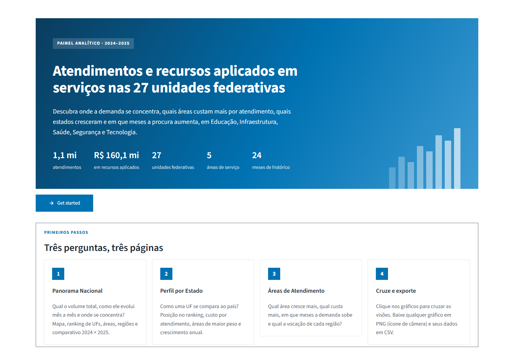
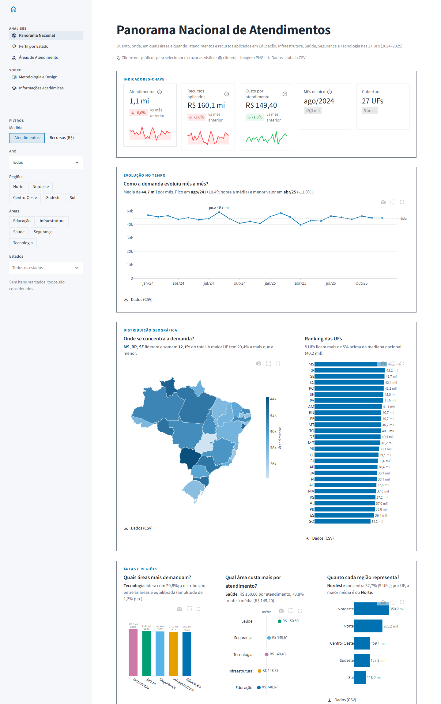
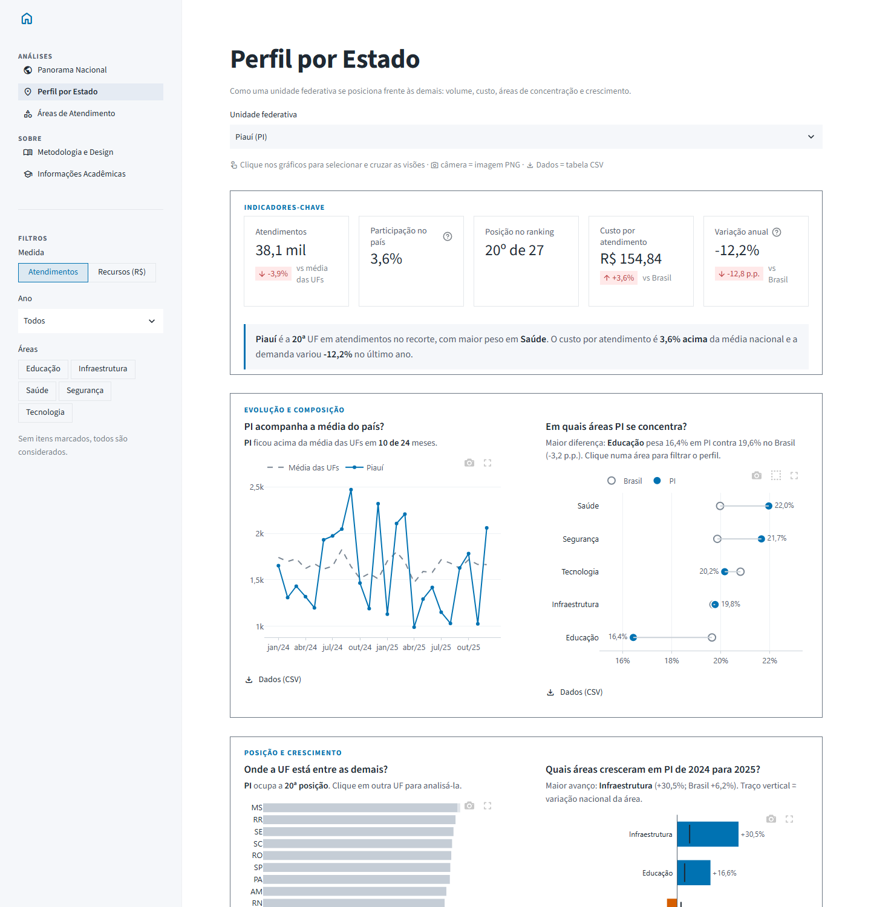
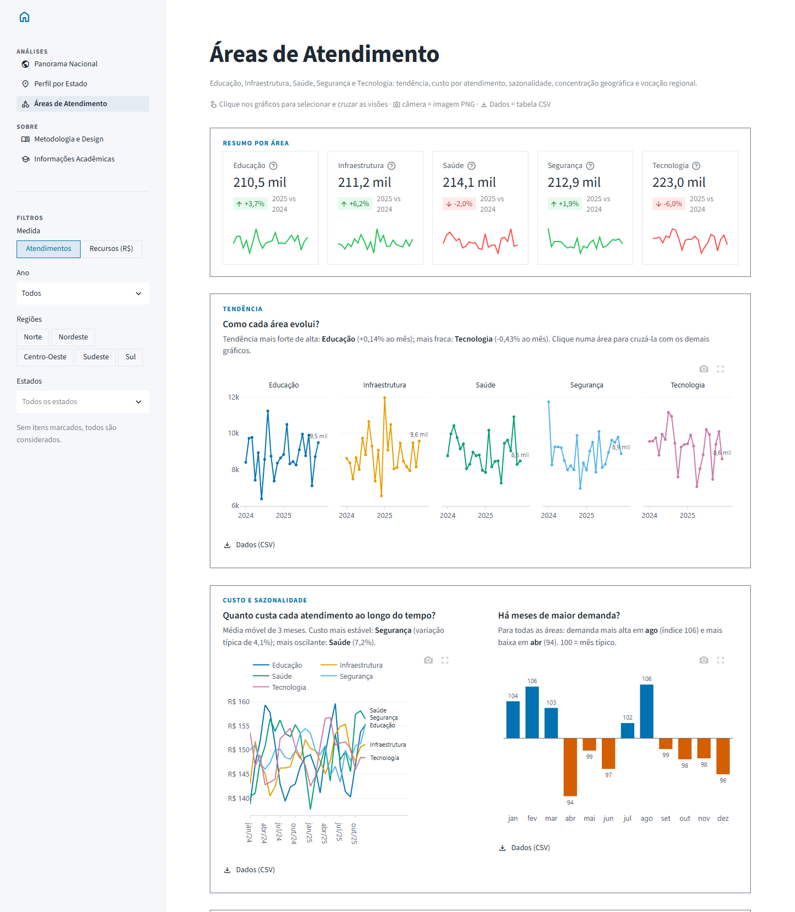

<div align="center">

# Painel Analítico de Atendimentos e Recursos por UF

**Onde a demanda se concentra, quanto custa cada atendimento, quais estados e áreas cresceram e em que meses a procura aumenta: Educação, Infraestrutura, Saúde, Segurança e Tecnologia nas 27 unidades federativas (2024–2025).**

[](https://dashboard-infovis.streamlit.app/)


[](https://github.com/cleristoncramos/dashboard-infovis-ufpi/actions/workflows/keep-alive.yml)

Trabalho da disciplina **Introdução à Visualização da Informação (InfoVis)** · Tecnólogo em Gestão de Dados · UFPI / CEAD



</div>

---

## Sumário

- [Visão geral](#visão-geral)
- [O que pode ser analisado](#o-que-pode-ser-analisado)
- [Páginas do painel](#páginas-do-painel)
- [Interação: Brushing & Linking](#interação-brushing--linking)
- [Exportação de dados e imagens](#exportação-de-dados-e-imagens)
- [Indicadores calculados](#indicadores-calculados)
- [Design: acessibilidade e Data-Ink Ratio](#design-acessibilidade-e-data-ink-ratio)
- [Dados](#dados)
- [Estrutura do projeto](#estrutura-do-projeto)
- [Como executar localmente](#como-executar-localmente)
- [Scripts utilitários](#scripts-utilitários)
- [Publicação e keep-alive](#publicação-e-keep-alive)
- [Tecnologias](#tecnologias)
- [Autoria e informações acadêmicas](#autoria-e-informações-acadêmicas)

---

## Visão geral

O painel organiza registros mensais de **atendimentos** e **recursos aplicados (R$)** por unidade federativa e área de serviço, e os apresenta seguindo o *Mantra da Busca de Informação Visual* de Shneiderman: **visão geral primeiro, depois zoom e filtro, e detalhes sob demanda**.

- **Acesso online:** <https://dashboard-infovis.streamlit.app/>
- **Entrada:** a página inicial apresenta o tema, os primeiros passos e um vídeo ilustrativo; o botão **Get started** abre o painel.
- **Navegação:** na barra lateral, o ícone de casa (canto superior) volta à página inicial; abaixo dele ficam as páginas de análise e os filtros.
- **Leitura orientada por perguntas:** cada gráfico tem um título em forma de pergunta e, logo abaixo, uma frase com a resposta calculada a partir do recorte atual (ela muda com filtros e seleções).

<div align="center">


*Prévia do vídeo ilustrativo exibido na página inicial, gerado a partir da própria base de dados.*

</div>

## O que pode ser analisado

| Tema | Perguntas respondidas |
|---|---|
| **Volume e evolução** | Quantos atendimentos foram realizados? Qual foi o mês de pico? 2025 superou 2024? |
| **Distribuição territorial** | Quais UFs e regiões concentram a demanda? Quanto os três maiores estados representam? |
| **Custo por atendimento** | Quanto se aplica, em média, por atendimento em cada área e em cada UF? |
| **Crescimento** | Quais estados e áreas cresceram ou recuaram de um ano para o outro? |
| **Sazonalidade** | Em quais meses a procura sobe ou cai, no total e em cada área? |
| **Concentração e vocação** | A demanda está espalhada ou concentrada? Em que área cada região se especializa? |

## Páginas do painel

### Panorama Nacional

Visão geral do país: indicadores-chave com minigráficos de tendência, evolução mensal, mapa coroplético e ranking das UFs, demanda e custo por área, totais por região, dispersão volume × custo por UF, mapa de calor área × mês, comparativo ano contra ano e variação anual por UF.

<details>
<summary>Ver captura de tela</summary>



</details>

### Perfil por Estado

Uma UF frente ao restante do país (abre no Piauí): posição no ranking, participação nacional, custo por atendimento e variação anual comparados ao Brasil; evolução mensal contra a média das UFs; composição por área (UF × Brasil); crescimento de cada área; tabela mensal. Clicar em outra UF no ranking troca o estado analisado.

<details>
<summary>Ver captura de tela</summary>



</details>

### Áreas de Atendimento

Análise temática das cinco áreas: cartões-resumo com variação anual, pequenos múltiplos da tendência mensal, custo por atendimento ao longo do tempo (média móvel de 3 meses), índice sazonal por mês, curvas de concentração entre as UFs e quociente locacional (vocação) por região.

<details>
<summary>Ver captura de tela</summary>



</details>

### Metodologia e Design · Informações Acadêmicas

Documentam os indicadores, a organização das páginas, a arquitetura de interação, os princípios de design e os créditos da disciplina.

## Interação: Brushing & Linking

A seleção feita em um gráfico **filtra** as demais visões e é **destacada** no gráfico de origem, que preserva o contexto (itens fora da seleção ficam em cinza ou translúcidos). As seleções ficam num estado global com quatro dimensões — **meses, estados, áreas e regiões** — e aparecem no topo da página como botões removíveis.

| Gesto | Efeito |
|---|---|
| **Clique** em barra, estado ou ponto | Adiciona ou remove o item da seleção (permite seleção múltipla) |
| **Caixa** ou **laço** (barra de ferramentas do gráfico) | Seleciona todos os itens da área desenhada |
| **Duplo clique** em área vazia | Limpa a seleção daquele gráfico |
| Botões **✕** no topo da página | Removem seleções individuais ou todas de uma vez |

Exemplos: selecionar estados no mapa destaca os mesmos estados no ranking, na dispersão e na variação anual, e recalcula indicadores, séries e tabela; no Perfil por Estado, clicar numa área filtra todo o perfil; nas Áreas de Atendimento, clicar num dos pequenos múltiplos realça a área em todos os gráficos da página.

## Exportação de dados e imagens

| Formato | Como exportar | Conteúdo |
|---|---|---|
| **PNG** | Ícone de câmera na barra de ferramentas de cada gráfico | Imagem do gráfico em resolução 2× |
| **CSV** | Botão **Dados (CSV)** abaixo de cada gráfico | Exatamente os números exibidos no gráfico |
| **CSV** | Botão ao final de cada página | Registros ou tabela mensal do recorte atual |

Os arquivos CSV usam `;` como separador e vírgula decimal, abrindo corretamente no Excel em português.

## Indicadores calculados

| Indicador | Cálculo | O que revela |
|---|---|---|
| Custo por atendimento | recursos ÷ atendimentos | eficiência relativa de áreas e UFs |
| Participação | valor do item ÷ total do recorte | peso de uma UF, região ou área |
| Variação anual | último ano ÷ ano anterior − 1 | crescimento ou retração |
| Tendência mensal | inclinação da reta de regressão ÷ média mensal | ritmo de crescimento de cada área |
| Índice sazonal | média do mês ÷ média geral × 100 | meses acima ou abaixo do típico |
| Curva de concentração | participação acumulada das UFs ordenadas | quão espalhada é a demanda |
| Quociente locacional | peso da área na região ÷ peso da área no Brasil | especialização regional (> 1) |

## Design: acessibilidade e Data-Ink Ratio

**Acessibilidade visual**

- Paleta categórica **Okabe-Ito**, com a ordem dos tons validada computacionalmente: pares adjacentes mantêm diferença perceptual (ΔE OKLab) ≥ 8 sob deuteranopia, protanopia e tritanopia.
- **A cor segue a entidade:** cada área mantém a mesma cor em todas as páginas e no vídeo.
- **Magnitude** em uma única matiz (azul, do claro ao escuro); **polaridade** em par divergente azul × vermelhão com meio neutro.
- A identidade nunca depende só da cor: rótulos diretos, ordenação, contorno nas seleções e tabelas de dados.

| Área | Cor | Área | Cor |
|---|---|---|---|
| Educação | `#0072B2` | Segurança | `#56B4E9` |
| Infraestrutura | `#E69F00` | Tecnologia | `#CC79A7` |
| Saúde | `#009E73` | Queda (divergente) | `#D55E00` |

**Data-Ink Ratio (Tufte)**

- Sem fundos, molduras ou legendas redundantes; rótulos diretos substituem eixos nas barras.
- Grade horizontal recessiva apenas onde a leitura de magnitude depende dela.
- Anotações seletivas (pico, média, mediana, último valor), nunca um número em cada ponto.
- Pequenos múltiplos com eixo compartilhado em vez de linhas sobrepostas.
- Interface com cantos retos e seções delimitadas por bordas finas e discretas.

## Dados

| Arquivo | Descrição |
|---|---|
| `data/vendas.csv` | 3.240 registros mensais (24 meses × 27 UFs × 5 áreas), jan/2024 a dez/2025 |
| `data/brasil-estados.geojson` | Malha estadual simplificada para o mapa (fonte: [click_that_hood](https://github.com/codeforamerica/click_that_hood)) |

Colunas de `vendas.csv`:

| Coluna | Tipo | Descrição |
|---|---|---|
| `data` | data | primeiro dia do mês de referência |
| `ano` | inteiro | ano de referência |
| `mes` | texto | mês no formato `AAAA-MM` |
| `estado` | texto | sigla da UF |
| `categoria` | texto | área de serviço |
| `atendimentos` | inteiro | quantidade de atendimentos no mês |
| `valor` | decimal | recursos aplicados no mês (R$) |

> **Importante:** a base é **simulada** pelo script `scripts/gerar_dados.py` (semente fixa, resultado reproduzível) para fins acadêmicos e **não representa estatísticas oficiais**. A região de cada UF é derivada no carregamento.

## Estrutura do projeto

```
dashboard-infovis-ufpi/
├── app.py                     # Ponto de entrada: configuração, estilo global e navegação
├── painel/                    # Páginas e recursos compartilhados
│   ├── base.py                # Dados, paleta, formatação, estado de seleção, gráficos e exportação
│   ├── inicio.py              # Página inicial (Get started, primeiros passos, vídeo)
│   ├── panorama.py            # Panorama Nacional
│   ├── estados.py             # Perfil por Estado
│   ├── areas.py               # Áreas de Atendimento
│   ├── metodologia.py         # Metodologia e Design
│   └── creditos.py            # Informações acadêmicas
├── data/
│   ├── vendas.csv             # Base de dados (simulada)
│   └── brasil-estados.geojson # Malha estadual simplificada
├── assets/
│   └── video_ilustrativo.mp4  # Vídeo exibido na página inicial
├── scripts/
│   ├── gerar_dados.py         # Gera data/vendas.csv
│   ├── gerar_video.py         # Gera assets/video_ilustrativo.mp4 a partir dos dados
│   └── keep_alive.py          # Visita o app publicado para evitar hibernação
├── docs/imagens/              # Capturas de tela e prévia usadas neste README
├── .streamlit/config.toml     # Tema (claro, cor primária da paleta)
├── .github/workflows/
│   └── keep-alive.yml         # Agendamento do keep-alive no GitHub Actions
├── requirements.txt           # Dependências do app
└── requirements-dev.txt       # Dependências extras para gerar o vídeo
```

## Como executar localmente

Pré-requisito: Python 3.12 ou superior.

```bash
git clone https://github.com/cleristoncramos/dashboard-infovis-ufpi.git
cd dashboard-infovis-ufpi
python -m venv .venv
```

Ative o ambiente virtual (`.venv\Scripts\activate` no Windows ou `source .venv/bin/activate` no Linux/macOS), instale as dependências e inicie o app:

```bash
pip install -r requirements.txt
streamlit run app.py
```

O painel abre em <http://localhost:8501>.

## Scripts utilitários

| Comando | O que faz |
|---|---|
| `python scripts/gerar_dados.py` | Recria `data/vendas.csv` (mesma semente, mesmo resultado) |
| `python scripts/gerar_video.py` | Recria o vídeo ilustrativo (~40 s, 1280×720) a partir dos dados; requer `pip install -r requirements-dev.txt` |
| `python scripts/keep_alive.py` | Abre o app publicado num navegador headless e o reativa se estiver hibernando; requer `pip install playwright` e `playwright install chromium` |

## Publicação e keep-alive

O painel está publicado no **Streamlit Community Cloud** a partir da branch `main`: cada push atualiza a versão online.

O Community Cloud hiberna apps sem visitas por algumas horas, e uma requisição HTTP simples não conta como visita. O workflow [`keep-alive.yml`](.github/workflows/keep-alive.yml) roda a cada 4 horas no GitHub Actions, abre o painel num Chromium headless e clica em *"Yes, get this app back up!"* se ele estiver hibernando. Também pode ser executado manualmente em **Actions → Keep-alive do painel → Run workflow**. Em caso de falha, uma captura de tela fica anexada à execução.

> O GitHub pausa workflows agendados em repositórios sem commits por 60 dias; nesse caso, basta reativá-lo na aba **Actions**.

## Tecnologias

- [Streamlit](https://streamlit.io/) — interface, navegação e estado de sessão
- [Plotly](https://plotly.com/python/) — gráficos interativos e eventos de seleção
- [pandas](https://pandas.pydata.org/) e [NumPy](https://numpy.org/) — preparação e agregação dos dados
- [Matplotlib](https://matplotlib.org/) e [imageio-ffmpeg](https://github.com/imageio/imageio-ffmpeg) — geração do vídeo ilustrativo
- [Playwright](https://playwright.dev/python/) e GitHub Actions — keep-alive do app publicado

## Autoria e informações acadêmicas

| | |
|---|---|
| **Instituição** | Universidade Federal do Piauí (UFPI) — Centro de Educação Aberta e a Distância (CEAD) |
| **Curso** | Tecnólogo em Gestão de Dados |
| **Disciplina** | Introdução à Visualização da Informação (InfoVis) — 2026.2 |
| **Professor** | Prof. MSc. Wesley Geraldo de Oliveira da Nóbrega |
| **Autor** | Clériston de Castro Ramos — [cleristoncramos@gmail.com](mailto:cleristoncramos@gmail.com) |
